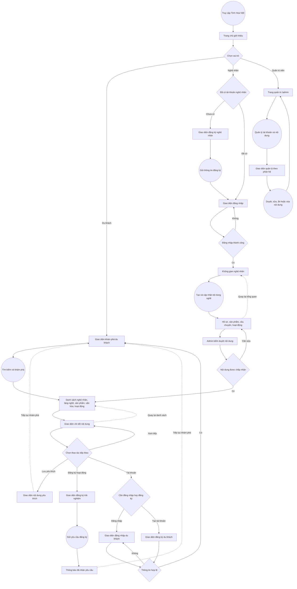
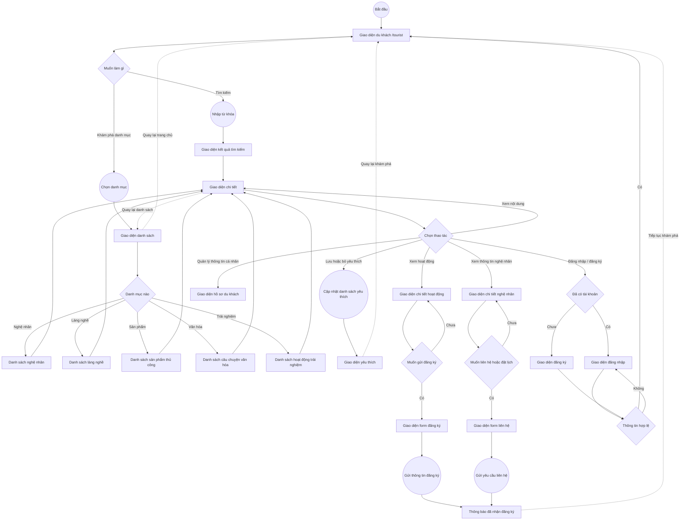
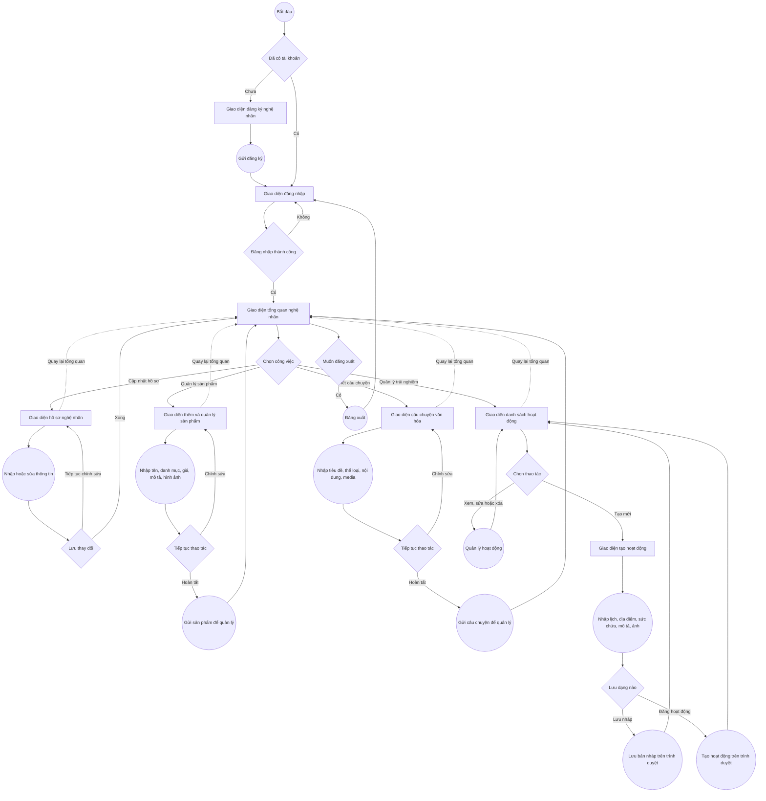
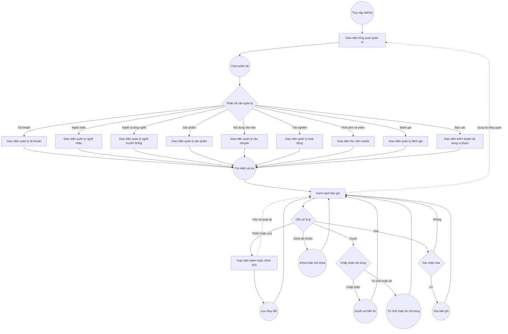

# User flow - Tinh Hoa Việt

Tài liệu mô tả luồng người dùng của hệ thống Tinh Hoa Việt theo các route và giao diện hiện có, kết hợp nghiệp vụ được mô tả trong README.

## Quy ước

- **Hình tròn**: hành động của người dùng/hệ thống.
- **Hình chữ nhật**: màn hình hoặc giao diện.
- **Hình thoi**: điểm người dùng cần chọn hoặc quyết định.
- **Mũi tên liền**: luồng đi tiếp.
- **Mũi tên nét đứt**: quay lại màn trước/danh sách.

## 1. Luồng tổng thể hệ thống

## 2. Luồng chi tiết - Du khách

## 3. Luồng chi tiết - Nghệ nhân

## 4. Luồng chi tiết - Quản trị viên

## Ghi chú về phạm vi hiện tại

- Du khách có thể xem danh mục, tìm kiếm, lưu yêu thích và xem các trang chi tiết. Yêu thích, hồ sơ và một số tương tác được lưu trong `localStorage`.
- Form đăng ký hoạt động/liên hệ hiện thông báo kết quả trên giao diện; luồng này chưa thể hiện thành quy trình đặt chỗ, thanh toán hay điều phối tour trên backend.
- Nghệ nhân có các giao diện hồ sơ, sản phẩm, câu chuyện và hoạt động. Tạo hoạt động hiện được lưu trên trình duyệt; các giao diện hồ sơ/sản phẩm/câu chuyện chưa đồng nghĩa với việc dữ liệu đã được đồng bộ backend.
- Admin có các màn hình quản lý tài khoản, nghệ nhân, nghề, sản phẩm, nội dung, hoạt động, media, đánh giá và báo cáo. Dữ liệu/chức năng quản trị trong giao diện hiện là mẫu; route `/admin` hiện chưa có màn đăng nhập hay guard phân quyền.
- Mua bán trực tuyến và thanh toán không nằm trong phạm vi hiện tại.
